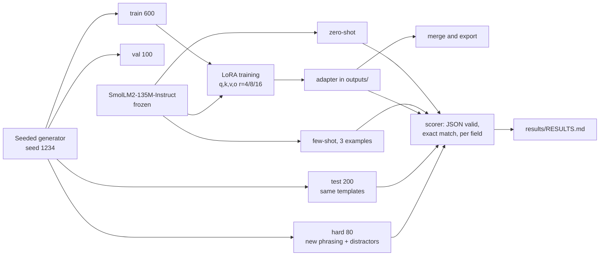

# llm-finetuning-lora

[](https://github.com/Avinash186200/llm-finetuning-lora/actions/workflows/ci.yml)
[](LICENSE)


I fine-tune a 135M-parameter open model with LoRA to turn short financial news sentences into strict JSON, and I compare it honestly against zero-shot and few-shot prompting. Everything runs on a laptop CPU in about two hours end to end.

## What problem this solves

A common question on a real project is: "Should we fine-tune, or is a better prompt enough?" People answer it from opinion. I wanted an answer from numbers, on a task small enough to rerun, with every step visible.

The task is structured extraction. Input, taken from my hard set: "For the 2023 third quarter, Veroria Group lagged while Mervorn Bank grew its net income to $752 million." Output:

```json
{"entity": "Mervorn Bank", "metric": "net income", "value": 752.0, "unit": "million", "period": "Q3 2023", "direction": "up"}
```

A script scores it, so there is no judge model and no hand rating.

## What you will learn

- How to set up a fair comparison: same model, same prompt, same decoding. Only the method changes.
- How LoRA works in code, in a plain PyTorch loop with no `Trainer`.
- How to mask the loss so the model only learns the answer.
- Why you split "in-distribution" test from a "hard" set, and why the gap between them matters more than either number.
- How to check that fine-tuning changed behaviour and did not add facts.
- How to merge an adapter back into the base model.
- One real bug I hit (silent truncation) and how a single assertion now prevents it.

## Key concepts

- **LoRA:** freeze the model; learn a low-rank update B x A beside chosen weight matrices, so you train about 1% of the parameters or less (0.34% at r = 4, 0.68% at r = 8, 1.35% at r = 16 here).
- **QLoRA:** LoRA on top of a base model loaded in 4-bit, so large models fit in small GPU memory.
- **PEFT:** parameter-efficient fine-tuning, the family of methods (and the Hugging Face library) that train a small add-on instead of the whole model.
- **Adapter merge:** fold B x A x (alpha / r) into the frozen weights, giving one normal model with no extra latency.
- **Catastrophic forgetting:** the model gets better at the new task and worse at things it knew before.
- **Constrained decoding:** force the output to follow a grammar or schema. Here I use a weaker, cheaper version: validate against the schema and retry once.

## How it works



Company names in val, test and hard never appear in train. All three methods share one instruction string. LoRA trains on that exact zero-shot prompt, so at test time the only difference between zero-shot and LoRA is the adapter.

## Results

All numbers below are copied from `results/RESULTS.md`, produced by `./run_all.sh`.

**Model:** `HuggingFaceTB/SmolLM2-135M-Instruct`. **Hardware:** CPU only, Intel Core Ultra 9 185H, 16 threads, float32, torch 2.15.0+cpu. No GPU: `torch.cuda.is_available()` is False on this machine. **Data seed:** 1234. **LoRA seeds:** 0, 1, 2 at r = 8; seed 0 for r = 4 and r = 16. Greedy decoding, 128-token cap. Latency is batch-of-16 wall time divided by 16.

### Main comparison (percent)

| Run | Method | Retry | Test valid | Test exact | Hard valid | Hard exact | ms/example (test) | Prompt tok | Gen tok |
|---|---|---|---|---|---|---|---|---|---|
| few_shot | few_shot | no | 46.0 | 10.0 | 51.2 | 0.0 | 1396.4 | 746.3 | 52.2 |
| few_shot_retry | few_shot | yes | 52.0 | 10.0 | 55.0 | 0.0 | 2128.5 | 1193.7 | 79.8 |
| lora_r16_s0 | lora | no | 100.0 | 100.0 | 98.8 | 26.2 | 602.2 | 161.3 | 51.3 |
| lora_r4_s0 | lora | no | 100.0 | 100.0 | 98.8 | 30.0 | 589.2 | 161.3 | 51.3 |
| lora_r8_s0 | lora | no | 100.0 | 100.0 | 98.8 | 26.2 | 567.0 | 161.3 | 51.3 |
| lora_r8_s0_retry | lora | yes | 100.0 | 100.0 | 98.8 | 26.2 | 490.9 | 161.3 | 51.3 |
| lora_r8_s1 | lora | no | 100.0 | 100.0 | 100.0 | 30.0 | 611.1 | 161.3 | 51.3 |
| lora_r8_s2 | lora | no | 100.0 | 100.0 | 100.0 | 28.7 | 584.2 | 161.3 | 51.3 |
| zero_shot | zero_shot | no | 0.0 | 0.0 | 0.0 | 0.0 | 1063.7 | 161.3 | 108.4 |
| zero_shot_retry | zero_shot | yes | 0.0 | 0.0 | 0.0 | 0.0 | 2337.2 | 468.4 | 216.8 |

### Per-field accuracy, hard set (percent)

| Run | entity | metric | value | unit | period | direction |
|---|---|---|---|---|---|---|
| few_shot | 28.7 | 70.0 | 46.2 | 2.5 | 20.0 | 70.0 |
| few_shot_retry | 26.2 | 67.5 | 46.2 | 2.5 | 20.0 | 68.8 |
| lora_r16_s0 | 53.8 | 95.0 | 83.8 | 98.8 | 68.8 | 72.5 |
| lora_r4_s0 | 58.8 | 96.2 | 86.2 | 97.5 | 70.0 | 70.0 |
| lora_r8_s0 | 57.5 | 95.0 | 86.2 | 96.2 | 66.2 | 71.2 |
| lora_r8_s0_retry | 57.5 | 95.0 | 86.2 | 96.2 | 66.2 | 71.2 |
| lora_r8_s1 | 57.5 | 96.2 | 86.2 | 96.2 | 73.8 | 70.0 |
| lora_r8_s2 | 60.0 | 96.2 | 87.5 | 96.2 | 65.0 | 71.2 |
| zero_shot | 0.0 | 0.0 | 0.0 | 1.2 | 1.2 | 1.2 |
| zero_shot_retry | 0.0 | 0.0 | 0.0 | 1.2 | 1.2 | 1.2 |

The test-set per-field table is in `results/RESULTS.md`. Every LoRA run is 100.0 on every field there.

### LoRA runs

| Run | r | alpha | lr | seed | Trainable | Total | Trainable % | Train s | Final val loss | Test exact | Hard exact |
|---|---|---|---|---|---|---|---|---|---|---|---|
| lora_r16_s0 | 16 | 32 | 0.0005 | 0 | 1,843,200 | 136,358,208 | 1.3517 | 1184.9 | 0.0033 | 100.0 | 26.2 |
| lora_r4_s0 | 4 | 8 | 0.0005 | 0 | 460,800 | 134,975,808 | 0.3414 | 1132.1 | 0.0059 | 100.0 | 30.0 |
| lora_r8_s0 | 8 | 16 | 0.0005 | 0 | 921,600 | 135,436,608 | 0.6805 | 1112.8 | 0.0044 | 100.0 | 26.2 |
| lora_r8_s1 | 8 | 16 | 0.0005 | 1 | 921,600 | 135,436,608 | 0.6805 | 1162.5 | 0.0047 | 100.0 | 30.0 |
| lora_r8_s2 | 8 | 16 | 0.0005 | 2 | 921,600 | 135,436,608 | 0.6805 | 1146.0 | 0.0048 | 100.0 | 28.7 |

"Total" includes the LoRA weights, which is why it changes with r. The base model alone is 134,515,008 parameters. Target modules: q_proj, k_proj, v_proj, o_proj. Two epochs, 150 steps, batch 8.

### LoRA by rank (mean ± std over seeds, percent)

| r | Seeds | Test exact | Hard exact | Hard valid |
|---|---|---|---|---|
| 4 | 0 | 100.0 | 30.0 | 98.8 |
| 8 | 0,1,2 | 100.0 ± 0.0 | 28.3 ± 1.9 | 99.6 ± 0.7 |
| 16 | 0 | 100.0 | 26.2 | 98.8 |

### Knowledge probes (percent)

| Run | Recall of training values (n=30) | World facts (n=10) |
|---|---|---|
| lora_r16_s0 | 0.0 | 90.0 |
| lora_r4_s0 | 0.0 | 90.0 |
| lora_r8_s0 | 0.0 | 90.0 |
| lora_r8_s1 | 0.0 | 90.0 |
| lora_r8_s2 | 0.0 | 90.0 |
| zero_shot | 0.0 | 70.0 |

### What I read from this

- **Fine-tuning taught the format.** Zero-shot produced no valid JSON at all. It copies the instruction into fields ("metric": "one of: revenue, ..."), adds keys like "symbol", and pretty-prints until the cap. Few-shot got about half valid. Every LoRA run is 100% valid and 100% exact on test.
- **It did not teach understanding.** On the hard set, LoRA stays valid (98.8 to 100%) but exact match falls to 26 to 30%. The weak fields are entity (it often picks the rival company), period (unseen forms like "3Q22") and direction (phrasing it never saw). The model learned my templates, not the task in general. A bigger model or more varied training sentences is the fix, not more epochs.
- **It did not teach facts.** I asked each tuned model for 30 values it saw during training. It got 0 of 30, same as the base. Training on extraction made it better at copying values from the input, not at storing them.
- **No forgetting showed up on my tiny probe.** World facts went from 7/10 (base) to 9/10 (tuned). With n = 10 that is noise, not an improvement. I read it as "no sign of forgetting", nothing more.
- **Rank did not matter here.** r = 4, 8 and 16 all hit 100% on test. On hard they sit between 26.2 and 30.0, inside the seed spread at r = 8 (28.3 ± 1.9). r = 4 trains a quarter of the parameters of r = 16 for the same result.
- **Retry did not help.** For the base models it added latency and tokens, lifted few-shot validity a little (46 to 52% on test) and did not change exact match. For few-shot it slightly lowered some per-field scores, because a retried answer can be valid JSON but wrong. For LoRA almost nothing failed validation, so retry had nothing to do. (Its lower latency there is run-to-run noise; it made one extra call.)
- **Fine-tuning is also cheaper at inference.** Few-shot needs a 746-token prompt; LoRA needs 161. On this CPU that is 567 vs 1396 ms per example.

### When to fine-tune, prompt, or use RAG

My rule of thumb, grounded in the numbers above:

| You need... | Use | Why, from this repo |
|---|---|---|
| A strict output format from a small or cheap model | Fine-tune (LoRA) | 0% to 100% valid on test. Prompting reached 46 to 52%. |
| The model to know facts it does not have | RAG (put the facts in the context) | Fine-tuning recalled 0 of 30 trained values. Facts belong in the input. |
| Robustness to inputs unlike your training data | Better data or a bigger model first | LoRA held format on hard but got 26 to 30% exact. Fine-tuning does not generalise past its data. |
| A quick baseline, few examples, changing requirements | Prompting | No training. Try it first and keep it if it is good enough. |
| Guaranteed parseable output | A real constrained decoder, plus validation | Validate-and-retry only helps when the model is close. |

Fine-tuning teaches format and behaviour, not facts.

## Limitations

- The data is synthetic and template-based. 100% on test means "learned the templates". The hard set is the honest number, and it is low.
- One small model (135M). A larger model would likely do far better zero-shot, which would shrink the case for fine-tuning. I did not test that.
- The hard set is 80 examples, so one example is 1.25 points. Differences under about 5 points are noise.
- Rank ablation and retry use one seed. Only r = 8 has three seeds.
- Retry is validation plus a second request, not grammar-constrained decoding.
- Latency is a batched CPU figure on one laptop. It is useful for comparing methods here, not as a production number.
- The QLoRA (4-bit, GPU) path is implemented but not run. I report no numbers for it.
- The knowledge probes are tiny (30 and 10 questions).

## Quick start

```bash
python -m venv .venv
source .venv/bin/activate            # Windows: .venv\Scripts\activate
pip install torch --index-url https://download.pytorch.org/whl/cpu
pip install -e ".[train,dev]"
pytest -q                            # no download needed

python -m lorafin.cli make_data
python -m lorafin.cli train --set lora.r=8 train.seed=0
python -m lorafin.cli evaluate --method lora --adapter outputs/adapters/lora_r8_s0 --label lora_r8_s0
python -m lorafin.cli compare

./run_all.sh                         # every number in this README, about 2 hours on CPU
```

The model (about 270 MB) downloads from Hugging Face on first use. No weights are committed. On a GPU, also `pip install -e ".[gpu]"`; the code then loads the base in 4-bit (QLoRA).

## Layout

```
configs/base.yaml        all settings; override with --set key=value
src/lorafin/
  data.py                seeded synthetic generator (train/val/test/hard)
  prompts.py             one instruction for every method; retry prompt
  scoring.py             JSON extraction, schema check, exact and per-field match
  modeling.py            model loading (CPU or 4-bit CUDA), batched greedy generation
  train.py               LoRA training loop with answer-only loss
  evaluate.py            runs a method on test and hard, plus knowledge probes
  compare.py             builds results/RESULTS.md
  export.py              merge adapter into base and save
  cli.py                 make_data, train, evaluate, compare, export
data/                    generated splits (committed so you can read them)
results/                 RESULTS.md and per-run JSON from my runs
tests/                   pytest; the tiny-model smoke test skips when offline
docs/methodology.md      what is measured and how
docs/walkthrough.md      step-by-step teaching path with exercises
run_all.sh               reproduces every result
outputs/                 adapters, predictions, merged model (gitignored)
```
